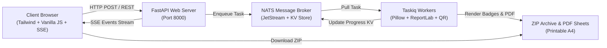

# 🎫 Badge & QR Maker

<div align="center">

[](https://fastapi.tiangolo.com)
[](https://www.python.org/)
[](https://nats.io)
[](https://taskiq-python.github.io)
[](https://tailwindcss.com)
[](https://www.docker.com/)
[](#-internationalization-i18n--darklight-themes)
[](https://opensource.org/licenses/MIT)

**A high-performance, open-source platform for generating printable event badges, conference passes, and QR codes at scale.**

[Key Features](#-key-features) • [Quick Start with Docker](#-quick-start-with-docker) • [Local Installation](#-local-installation) • [API Documentation](#-api-endpoints) • [Architecture](#-architecture--tech-stack)

</div>

---

## 🌟 Key Features

### 🎨 Visual Drag-and-Drop Card Builder
- **Interactive Canvas (450 × 300 px)**: Drag and reposition any element directly with mouse or touch, or fine-tune exact pixel coordinates (`X`, `Y`) and font sizes with sliders.
- **Custom Background Color & Smart Contrast**: Choose from curated VIP palettes (`Navy VIP`, `Graphite`, `Classic Blue`, `Emerald`, `Purple`, etc.) or enter any custom HEX color. The engine automatically computes WCAG luminance to ensure text elements stay readable.
- **Smart-Cropped Image Backgrounds**: Upload any photo, poster, or brand banner; the engine automatically applies smart 3:2 aspect-ratio cropping (`LANCZOS` filter).
- **Top Accent Line Customization**: Toggle the top accent bar on/off, customize its height (1–50 px), and assign custom accent colors.
- **In-Place Editable Header Tag**: Double-click or type directly in the editor to customize the category pill (e.g., `VIP GUEST`, `CONFERENCE PASS`, `SPEAKER`, `ORGANIZER`). Leave blank to hide.
- **Arbitrary Custom Text Blocks**: Click `+ Add Custom Text` (`+ Добавить текст`) to create custom text layers (e.g., `HALL A`, `TABLE 5`, `PRESS`, `Wi-Fi: Conf2026`). Position, style, recolor, and delete them freely.

---

### 📱 Dynamic QR Code Generator & Direct Link Mode
- **Configurable Data Payload**: Select exactly which fields appear in the QR code:
  - ☑️ Full Name / Name
  - ☑️ Badge ID
  - ☑️ Event Date
  - ☑️ Phone Number
  - ☑️ Website URL
- **Direct Link Mode**: If only the website field is selected, scanning the badge immediately opens the URL in the mobile browser instead of displaying raw text.
- **Custom QR Styling**: Match QR code dark modules to your badge theme color.

---

### 📞 Contact Info on Badges (Phone & Website)
- **Flexible Fields**: Add phone numbers and website links individually per attendee (via Excel/CSV or text) or set global fallbacks.
- **Graceful Empty State**: If phone or website is omitted, the card layout adapts cleanly without broken placeholders or awkward gaps.

---

### 📜 Infinite Pagination & Real-Time Search
- **No More Fixed Cutoffs**: Replaces arbitrary row limits (`slice(0, 10)`) with an enterprise-grade virtual infinite scroll.
- **Smooth Chunked Loading**: Loads attendees in batches of 25 records as you scroll down the container, preserving browser responsiveness even with 500+ attendees.
- **Instant Live Search**: Filter the attendee list in real time by Name, Phone, Website, or `#ID`.
- **Show All & Quick Stats**: Instant counter indicator (`Showing X of Y attendees` / `Found X of Y`) and a one-click "Show All" toggle.
- **Universal Table Viewer**: Click `Preview Table` (`Таблица участников`) in Step 3 to inspect parsed attendees at any time across Text, Excel/CSV, and JSON tabs.

---

### 👥 Flexible Attendee Importer
- **Text List**: Paste plain text lists with smart line-by-line parsing (`Alexander Smith, +1 555-0199, company.com`).
- **Excel (.xlsx, .xls) & CSV**: Drag-and-drop spreadsheets with automatic column mapping (`First Name`, `Last Name`, `Full Name`, `Phone`, `Website`).
- **JSON Payload**: Directly provide structured JSON payloads via REST API.

---

### 🌐 Internationalization (i18n) & Dark/Light Themes
- **Bilingual Interface**: 100% translated into **English (`en`)** and **Russian (`ru`)**.
- **Auto-Detection**: Automatically detects the browser's preferred language (defaults to English if non-Russian).
- **Theme Switcher**: Modern Dark and Light themes with smooth CSS transitions, system preference sync (`prefers-color-scheme`), and persistent storage in `localStorage` with zero flashing (anti-FOUC).

---

### ⚡ Distributed Task Engine & Real-Time Progress
- **Non-blocking Asynchronous Execution**: Badge batches are rendered by distributed **Taskiq** background workers via **NATS JetStream**.
- **Zero-Polling Live Progress (SSE)**: Real-time progress updates (0% to 100%) delivered via **Server-Sent Events** without hammering the server.
- **Printable A4 Sheet Compiler**: Automatically packs 8 badges per A4 sheet with calibrated cut marks for guillotine card cutters.
- **Individual ZIP Archive**: Downloads a single `.zip` containing all high-resolution PNG badges, printable PDF sheets, and isolated QR codes.

---

### ⏱️ Hourly Automated Cleanup & Smart Retention
- **Automated Hourly Sweep**: Background cleanup cron runs every 1 hour (3600 seconds).
- **Downloaded Project Deletion**: Projects already transmitted/downloaded by the user (`.downloaded` marker file) are automatically removed on the next hourly cycle.
- **Retention Expiry**: Orphaned or un-downloaded projects older than 1 hour are cleaned up automatically to prevent disk bloating.
- **Directory Protection**: Custom user-saved templates (`templates/custom/`), preview cards (`templates/previews/`), and system assets are strictly protected from deletion.

---

## 🚀 Quick Start with Docker

Deploy on any Linux, macOS, or Windows server in less than a minute.

### 1. Clone the repository
```bash
git clone https://github.com/your-username/badge-qr-maker.git
cd badge-qr-maker
```

### 2. Launch with Docker Compose
```bash
docker compose up -d --build
```

The orchestration automatically brings up:
1. `badge_nats`: NATS server with JetStream and HTTP monitoring on Alpine Linux.
2. `badge_web`: FastAPI web server and UI frontend.
3. `badge_worker`: Taskiq distributed worker processes.

### 3. Open your browser
- **Web Interface**: [http://localhost:8000](http://localhost:8000)
- **Interactive Swagger API Docs**: [http://localhost:8000/docs](http://localhost:8000/docs)
- **NATS Dashboard**: [http://localhost:8222](http://localhost:8222)

To view logs:
```bash
docker compose logs -f
```

To stop:
```bash
docker compose down
```

---

## 🛠️ Local Installation

If you prefer running services directly on your host machine:

### Prerequisites
- **Python 3.11+**
- **NATS Server** with JetStream enabled ([Install NATS](https://docs.nats.io/running-a-nats-service/introduction/installation))

### 1. Setup Virtual Environment
```bash
# Clone the repository
git clone https://github.com/your-username/badge-qr-maker.git
cd badge-qr-maker

# Create and activate virtual environment
python -m venv .venv

# On Linux/macOS:
source .venv/bin/activate

# On Windows:
.\.venv\Scripts\activate
```

### 2. Install Dependencies
```bash
pip install --upgrade pip
pip install -e .
```

### 3. Start NATS Server (Terminal 1)
```bash
nats-server -js
```

### 4. Start Taskiq Background Worker (Terminal 2)
```bash
# On Linux/macOS:
taskiq worker config.tasiq:broker tasks.index_card --reload

# On Windows:
.\.venv\Scripts\taskiq worker config.tasiq:broker tasks.index_card --reload
```

### 5. Start FastAPI Server (Terminal 3)
```bash
python main.py
```

The web app is now live at **http://localhost:8000/**.

---

## ⚙️ Environment Variables

Configure application settings via environment variables or a `.env` file:

| Variable | Default | Description |
|---|---|---|
| `NATS_URL` | `nats://localhost:4222` | Connection string to NATS message broker |
| `PYTHONUNBUFFERED` | `1` | Forces stdout and stderr streams to be unbuffered |

---

## 📡 API Endpoints

The FastAPI backend provides full OpenAPI (Swagger) documentation available at `/docs`:

### Web Interface & Templates
| Method | Endpoint | Description |
|---|---|---|
| `GET` | `/` | Web frontend SPA interface |
| `GET` | `/api/templates` | List built-in & custom saved templates with preview URLs |
| `GET` | `/api/templates/{id}/preview` | Generated PNG photo preview of a template |
| `POST` | `/api/templates/upload-background` | Upload and smart-crop a custom background image |
| `POST` | `/api/templates/custom` | Save a new design layout from the builder |
| `DELETE` | `/api/templates/custom/{id}` | Delete a custom saved template |

### Employee Import & Parsing
| Method | Endpoint | Description |
|---|---|---|
| `POST` | `/api/upload-employees` | Parse `.xlsx`, `.xls` or `.csv` spreadsheet file |
| `POST` | `/api/parse-text-employees` | Parse plain text line-by-line employee list |

### Batch Generation & Streaming
| Method | Endpoint | Description |
|---|---|---|
| `POST` | `/api/create_card` | Enqueue batch badge generation task |
| `GET` | `/api/stream/{project_uuid}` | Real-time Server-Sent Events (SSE) progress stream |
| `GET` | `/api/download/{project_uuid}` | Download completed `.zip` archive (marks `.downloaded`) |

---

## 🧩 Architecture & Tech Stack



- **Backend**: [FastAPI](https://fastapi.tiangolo.com/), Python 3.11+, Pydantic v2
- **Task Queue & Message Broker**: [Taskiq](https://taskiq-python.github.io/), [NATS JetStream](https://nats.io)
- **Image Processing**: [Pillow (PIL)](https://python-pillow.org/) with Montserrat typography
- **QR Generation**: [qrcode](https://github.com/lincolnloop/python-qrcode) with customized data payloads
- **Document Generation**: [ReportLab](https://www.reportlab.com/) for A4 printable grid with cutting guidelines
- **Frontend**: Single-page application, Tailwind CSS, SheetJS (XLSX), Server-Sent Events (SSE)
- **Deployment**: Docker, Docker Compose

---

## 📂 Project Structure

```
.
├── config/
│   └── tasiq.py            # Taskiq broker & NATS connection configuration
├── routes/
│   ├── route.py            # Main API router aggregator
│   └── create_card.py      # Endpoints for templates, uploads, generation, and SSE
├── schemas/
│   └── data_schema.py      # Pydantic models for attendees and payloads
├── static/
│   └── index.html          # Full-featured responsive SPA UI with builder & i18n
├── tasks/
│   └── index_card.py       # Distributed worker tasks (batch generator & cleanup cron)
├── templates/              # Directory for built-in, custom, and preview badge templates
│   ├── custom/             # User-saved custom template layouts (JSON)
│   └── previews/           # Auto-rendered preview images (PNG)
├── utils/
│   ├── create_template.py  # Base template initializer
│   ├── fonts.py            # Font loader & dynamic text auto-fitting
│   ├── importer.py         # Excel (.xlsx) and CSV table parser
│   ├── pdf.py              # A4 printable sheets layout & PDF compiler
│   └── templates.py        # Core Pillow badge rendering engine
├── Dockerfile              # Container definition for server deployment
├── docker-compose.yml      # Orchestration for NATS, web, and worker services
├── pyproject.toml          # Project metadata and dependencies
└── README.md               # Documentation
```

---

## 🤝 Contributing

Contributions are welcome! Please feel free to submit a Pull Request.

1. Fork the repository
2. Create your feature branch (`git checkout -b feature/amazing-feature`)
3. Commit your changes (`git commit -m 'Add amazing feature'`)
4. Push to the branch (`git push origin feature/amazing-feature`)
5. Open a Pull Request

---

## 📄 License

This project is open-source and licensed under the [MIT License](LICENSE).
