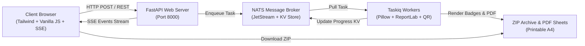

# 🎫 Badge & QR Maker

<div align="center">

[](https://fastapi.tiangolo.com)
[](https://www.python.org/)
[](https://nats.io)
[](https://taskiq-python.github.io)
[](https://tailwindcss.com)
[](https://www.docker.com/)
[](https://opensource.org/licenses/MIT)

**A high-performance, open-source platform for generating printable event badges, conference passes, and QR codes at scale.**

[Features](#-key-features) • [Quick Start with Docker](#-quick-start-with-docker) • [Local Installation](#-local-installation) • [API Documentation](#-api-endpoints) • [Tech Stack](#-architecture--tech-stack)

</div>

---

## 🌟 Key Features

### 🎨 Visual Card Builder
- **Interactive Drag-and-Drop Canvas** (450 × 300 px): Reposition any element directly with your mouse or finger, or fine-tune coordinates down to the exact pixel with sliders.
- **Custom Backgrounds with Smart Crop**: Upload any photo or banner; the system automatically performs intelligent 3:2 aspect ratio cropping (`LANCZOS` fit).
- **Background Palette**: Choose from curated VIP and tech palettes or pick any custom HEX color with automated light/dark contrast text adaptation.
- **Accent Line Customization**: Toggle, recolor, and adjust the height of the top decorative bar.
- **Top Tag / Header Element**: Double-click directly on the badge to customize the category tag (e.g., `VIP GUEST`, `CONFERENCE PASS`, `SPEAKER`, `ORGANIZER`).
- **Arbitrary Custom Text Blocks**: Click `+ Add Text` (`+ Добавить текст`) to create custom text layers (e.g., `HALL A`, `TABLE 5`, `PRESS`, `Wi-Fi: Conf2026`). Move, resize, recolor, and delete them at will.

### ⚡ Scalable & Distributed Architecture
- **Non-blocking Background Processing**: Tasks are handled asynchronously via **Taskiq** workers and **NATS JetStream**, allowing your server to generate thousands of badges without freezing the UI.
- **Real-Time Live Progress Bar**: Follow progress with zero polling using **Server-Sent Events (SSE)**.
- **Automated Housekeeping**: Background cron automatically cleans up generated zip archives and files older than 2 hours.

### 🖨️ Ready-to-Print A4 Sheets & High-Res PNGs
- **Printable PDF Sheets**: Packs 8 badges per A4 page with clean cutting guidelines for standard card cutters.
- **Individual ZIP Archive**: Includes separate high-resolution PNG badges, printable PDF sheets, and isolated QR codes for each attendee.

### 📱 Dynamic QR Code Generator
- Select which data fields to embed into the QR code: `Full Name`, `ID`, `Date`, `Phone`, `Website`.
- **Direct Link Mode**: If only the website is enabled, scanning the QR code immediately opens the link in the user's mobile browser.

### 👥 Flexible Attendee Importer
- **Text List**: Paste lists of attendees (one per line, auto-parsing names, phone numbers, and websites).
- **Excel (.xlsx, .xls) & CSV**: Drag-and-drop spreadsheets with automatic column recognition (`Name`, `Surname`, `Full Name`, `Phone`, `Website`).
- **JSON Payload**: Directly supply JSON arrays via REST API.

### 🌐 Internationalization (i18n) & Dark/Light Themes
- **Languages**: Full Russian (`ru`) and English (`en`) support with automatic browser language detection (defaults to English if non-Russian).
- **Themes**: Modern dark and light themes with smooth transition and anti-FOUC (flashing prevention) persistence in `localStorage`.

---

## 🚀 Quick Start with Docker

Deploy on any Linux, macOS, or Windows server in less than a minute.

### 1. Clone the repository
```bash
git clone https://github.com/your-username/badge-qr-maker.git
cd badge-qr-maker
```

### 2. Launch with Docker Compose
```bash
docker compose up -d --build
```

### 3. Open your browser
- **Web Interface**: [http://localhost:8000](http://localhost:8000)
- **Interactive Swagger API Docs**: [http://localhost:8000/docs](http://localhost:8000/docs)
- **NATS Dashboard**: [http://localhost:8222](http://localhost:8222)

To view logs:
```bash
docker compose logs -f
```

To stop:
```bash
docker compose down
```

---

## 🛠️ Local Installation

If you prefer running services directly on your host machine:

### Prerequisites
- **Python 3.11+**
- **NATS Server** with JetStream enabled ([Install NATS](https://docs.nats.io/running-a-nats-service/introduction/installation))

### 1. Setup Virtual Environment
```bash
# Clone the repository
git clone https://github.com/your-username/badge-qr-maker.git
cd badge-qr-maker

# Create and activate virtual environment
python -m venv .venv

# On Linux/macOS:
source .venv/bin/activate

# On Windows:
.\.venv\Scripts\activate
```

### 2. Install Dependencies
```bash
pip install --upgrade pip
pip install -e .
```

### 3. Start NATS Server (in terminal 1)
```bash
nats-server -js
```

### 4. Start Taskiq Background Worker (in terminal 2)
```bash
# On Linux/macOS:
taskiq worker config.tasiq:broker tasks.index_card --reload

# On Windows:
.\.venv\Scripts\taskiq worker config.tasiq:broker tasks.index_card --reload
```

### 5. Start FastAPI Server (in terminal 3)
```bash
python main.py
```

The web app is now available at **http://localhost:8000/**.

---

## ⚙️ Environment Variables

Configure application settings via environment variables or a `.env` file:

| Variable | Default | Description |
|---|---|---|
| `NATS_URL` | `nats://localhost:4222` | Connection string to NATS message broker |
| `PYTHONUNBUFFERED` | `1` | Forces stdout and stderr streams to be unbuffered |

---

## 📡 API Endpoints

The FastAPI backend provides full OpenAPI (Swagger) documentation available at `/docs`:

### Web Interface & Templates
| Method | Endpoint | Description |
|---|---|---|
| `GET` | `/` | Web frontend UI |
| `GET` | `/api/templates` | List base & custom saved templates |
| `GET` | `/api/templates/{id}/preview` | Generated PNG photo preview of a template |
| `POST` | `/api/templates/upload-background` | Upload and smart-crop a custom background image |
| `POST` | `/api/templates/custom` | Save a new design layout from the builder |
| `DELETE` | `/api/templates/custom/{id}` | Delete a custom saved template |

### Employee Import
| Method | Endpoint | Description |
|---|---|---|
| `POST` | `/api/upload-employees` | Parse `.xlsx`, `.xls` or `.csv` employee file |
| `POST` | `/api/parse-text-employees` | Parse plain text line-by-line employee list |

### Batch Generation & Streaming
| Method | Endpoint | Description |
|---|---|---|
| `POST` | `/api/create_card` | Enqueue batch badge generation task |
| `GET` | `/api/tasks/{uuid}/events` | Real-time Server-Sent Events (SSE) progress stream |
| `GET` | `/api/download/{uuid}` | Download completed `.zip` archive |

---

## 🧩 Architecture & Tech Stack



- **Backend**: [FastAPI](https://fastapi.tiangolo.com/), Python 3.11+, Pydantic v2
- **Task Queue & Message Broker**: [Taskiq](https://taskiq-python.github.io/), [NATS JetStream](https://nats.io)
- **Image Processing**: [Pillow (PIL)](https://python-pillow.org/) with Montserrat typography
- **QR Generation**: [qrcode](https://github.com/lincolnloop/python-qrcode) with customized data payloads
- **Document Generation**: [ReportLab](https://www.reportlab.com/) for A4 printable grid with cut marks
- **Frontend**: Single-page application, Tailwind CSS, SheetJS (XLSX), Server-Sent Events (SSE)
- **Deployment**: Docker, Docker Compose

---

## 📂 Project Structure

```
.
├── config/
│   └── tasiq.py            # Taskiq broker & NATS connection configuration
├── routes/
│   ├── route.py            # Main API router aggregator
│   └── create_card.py      # Endpoints for templates, uploads, generation, and SSE
├── schemas/
│   └── data_schema.py      # Pydantic models for attendees and payloads
├── static/
│   └── index.html          # Full-featured responsive SPA UI with builder & i18n
├── tasks/
│   └── index_card.py       # Distributed worker tasks (batch generator & cleanup cron)
├── templates/              # Directory for built-in, custom, and preview badge templates
├── utils/
│   ├── create_template.py  # Base template initializer
│   ├── fonts.py            # Font loader & dynamic text auto-fitting
│   ├── importer.py         # Excel (.xlsx) and CSV table parser
│   ├── pdf.py              # A4 printable sheets layout & PDF compiler
│   └── templates.py        # Core Pillow badge rendering engine
├── Dockerfile              # Container definition for server deployment
├── docker-compose.yml      # Orchestration for NATS, web, and worker services
├── pyproject.toml          # Project metadata and dependencies
└── README.md               # Documentation
```

---

## 🤝 Contributing

Contributions are welcome! Please feel free to submit a Pull Request.

1. Fork the repository
2. Create your feature branch (`git checkout -b feature/amazing-feature`)
3. Commit your changes (`git commit -m 'Add amazing feature'`)
4. Push to the branch (`git push origin feature/amazing-feature`)
5. Open a Pull Request

---

## 📄 License

This project is open-source and licensed under the [MIT License](LICENSE).
